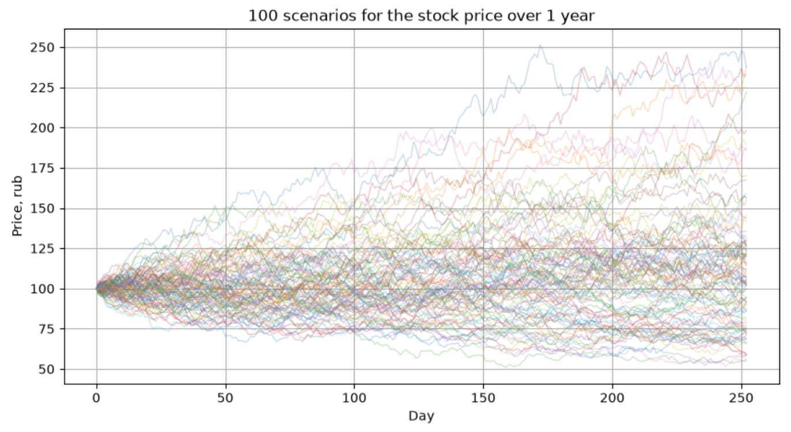
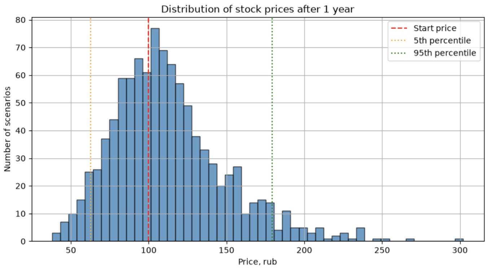
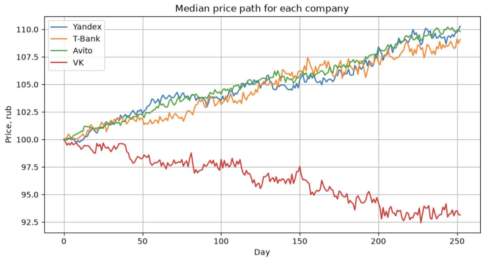

# Stock Simulator

A Monte Carlo simulation of stock prices using NumPy and Matplotlib.

Every trading day the price changes by a random percentage drawn from a normal distribution. Repeating the simulation 1000 times gives an estimate of the price in one year, the probability of profit and the range of realistic outcomes.

## What the project does

1. Generates random daily returns for 1000 scenarios over 252 trading days.
2. Converts returns into prices with `np.cumprod`.
3. Calculates statistics of the final prices: mean, median, probability of profit, 5th and 95th percentiles.
4. Compares four companies with different growth and volatility using a 3D array `(companies, scenarios, days)`.

## Results

### 100 price scenarios



### Distribution of final prices



| Metric | Value |
|---|---|
| Mean price | 112.65 |
| Median price | 107.35 |
| Probability of profit | 60.6% |
| 5th percentile | 62.52 |
| 95th percentile | 179.43 |

### Comparison of companies

Parameters are made up for learning purposes and are not real market data.



| Company | Mean price | Probability of profit | 5th percentile | 95th percentile |
|---|---|---|---|---|
| Yandex | 116.02 | 60.8% | 65.88 | 186.76 |
| T-Bank | 120.08 | 58.2% | 54.10 | 221.81 |
| Avito | 113.90 | 66.7% | 73.85 | 165.70 |
| VK | 103.85 | 43.7% | 44.92 | 201.74 |

A higher mean return does not make a stock better: T-Bank has the highest mean price, but Avito has the highest probability of profit thanks to lower volatility.

## Technologies

- Python
- NumPy: random generation, `cumprod`, boolean masks, percentiles, reshape and broadcasting, 3D arrays
- Matplotlib: line charts and histograms
- Jupyter Lab

## How to run

```bash
git clone https://github.com/kupetss/stock-simulator.git
cd stock-simulator
pip install -r requirements.txt
jupyter lab
```

Then open `stock_simulator.ipynb` and run all cells.